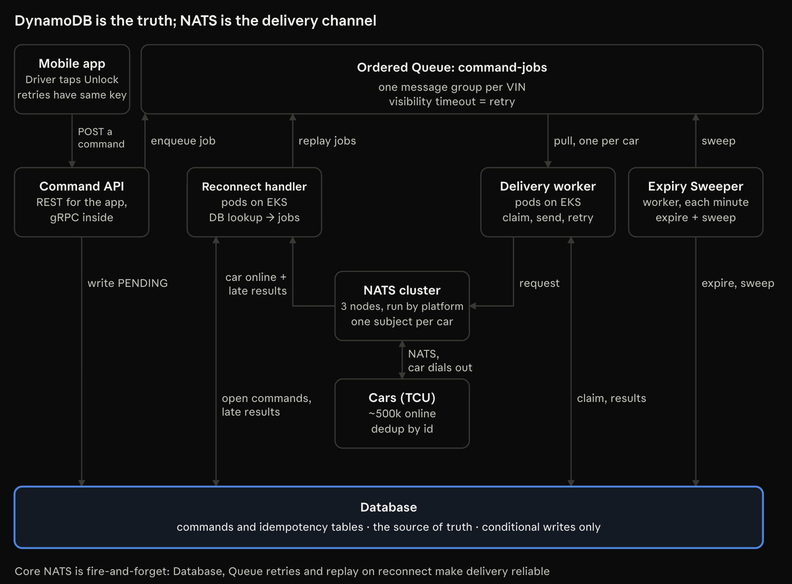
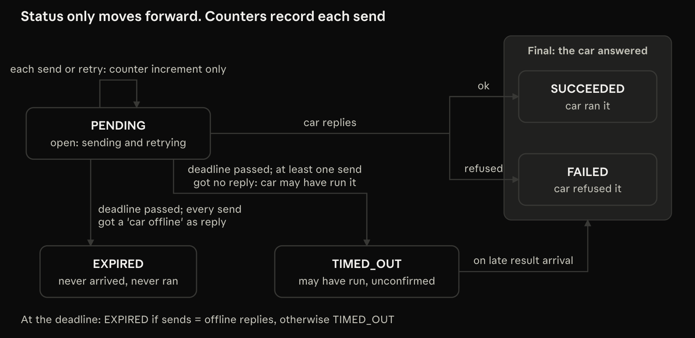

Designed with love, especially for RV Tech Connectivity Team.
## Problem statement in one line 

A cloud-to-device (C2D) command delivery system : Accept remote command for a car from a user mobile app and deliver it to that specific car exactly once in effect, in order, and only while it is still valid, even when the car's network is flaky or, our own system crashes.

**Example:** At 07:58 a driver taps "Unlock" in the app. The car is in an underground garage with one bar of LTE. Three things can go wrong:
- The command never reaches the car, and the driver is stuck outside his locked car.
- It arrives twice. Usually harmless: a repeated "unlock", "honk the horn" or "open the frunk" leaves the car as it was, or is just annoying. It is harmful for toggles and relative commands, such as "toggle frunk" or "add 10 minutes of pre-conditioning climate", where a repeat undoes or doubles the action.
- It arrives 20 minutes later, after the driver has walked away. Now an unlocked car sits in a public garage, waiting to get stolen.

---
## **The TLDR version** 

Save every command in the database first, deliver it through an ordered queue over a NATS cluster as a request to the online car whose reply is the result; retry when car comes back online if offline, and let the car reject duplicates by commandId: at-least-once delivery plus a car that dedupes gives an effect that happens exactly once.

**Tech used in this design**

| For                      | Tech                                                                                   | Why                                                                                               |
| ------------------------ | -------------------------------------------------------------------------------------- | ------------------------------------------------------------------------------------------------- |
| Car link                 | NATS cluster, request-reply, Protobuf payloads                                         | reply is the result. "no responders" says at once that a car is offline                           |
| Source of truth          | DynamoDB: `commands` and `idempotency` tables, conditional writes only                 | No failover pause, no connection pooling, design stays same for future scaling                    |
| Job queue and retries    | SQS FIFO, message group = VIN                                                          | One job per car in flight keeps order. The visibility timeout is the retry timer. Built-in dedupe |
| Our services             | Command API (REST for the mobile app), Delivery worker, Reconnect handler: pods on EKS | Stateless, scale by adding pods. They hold no car connections, so deploys disconnect nobody       |
| Deadlines and safety net | Expiry Sweeper: a Lambda run every minute by Scheduled EventBridge                     | Closes overdue commands when cars come back online, and re-queues the rare job lost in a crash    |

**Key ideas**

- A command's status only moves forward: `PENDING` → `SUCCEEDED` / `FAILED` / `EXPIRED` / `TIMED_OUT`, and a late result (when car comes back online) can only settle`TIMED_OUT`→ `SUCCEEDED` / `FAILED.`
- Every status change is a conditional write, so the three workers never overwrite each other.
- An offline car gets its open commands replayed when it reconnects.
- At the deadline: `EXPIRED` if every send found the car offline (it never ran), otherwise `TIMED_OUT` (it may have run).
- The car keeps the commandIds it has run in flash, so a repeat never runs twice.

The sections below explain how each part works and why it was chosen.

----
## Understanding the system 

Mobile App --> This System (on Cloud) --> NATS cluster <--> Car

This system has two halves with opposite personalities:
- An **accept path** that must never lose a command. The app sends it, system stores it durably, and answer within milliseconds.
- A **delivery path** : For this, we need a live connection from our system to the car. But system can't connect to the car on its own. Because :
	- Carriers (mobile network company that gives the car its internet through SIM card) put the car behind carrier NAT, so car has no public address for our system to reach it.
	- Cars IP address also changes as it drives between cell towers.

	So the car has to open a connection to our system, which our system can then use for
command delivery to the car.
<br>  
There are ways to do this connection: polling, WebSocket, MQTT(AWS IoT Core/self-hosted broker), gRPC stream, NATS cluster; each with its own trade-offs.
<br>  
**NOTE** : For sake of simplicity, we are gonna assume, cars connect to our **already existing NATS cluster**. This system, which we are designing is also its client. We discuss the reasons in more detail in Architecture Decision Record (refer ADR-4).
<br>  
So the delivery path hands each command to NATS cluster, which finds the car's connection. Our systems job is everything around that: **correctness**: keep the command safe until the car answers, survive drops and crashes, and stop retrying once the command expires.
<br><br>


|              | Accept path                                        | Delivery path                                                            |
| ------------ | -------------------------------------------------- | ------------------------------------------------------------------------ |
| Talk b/w     | app -> system: reliable, can retry                 | system -> car: flaky, drops off                                          |
| Connection   | short HTTP request                                 | cars keeps a connection to the existing NATS cluster                     |
| Speed        | answer in ms                                       | can wait minutes for delivery to car                                     |
| State        | stateless                                          | NATS finds the car's connection; our system tracks each command's status |
| Failure rule | never lose a command: refuse (503) rather than lie | retry: resend command until acked by the car, or expires                 |
| Scales with  | how often the users tap                            | how many commands are in flight (NATS scales with online cars)           |
Opposite personalities : The accept path is a fast, stateless promise. The delivery path is slow, stateful and patient. Our system needs to be split into micro-services so that each can scale and fail on its own terms.

<br>

#### **Domain Terminologies**

| Term            | Meaning                                                                                                                                                                                                                                             | Notes                                                                                                                            |
| --------------- | --------------------------------------------------------------------------------------------------------------------------------------------------------------------------------------------------------------------------------------------------- | -------------------------------------------------------------------------------------------------------------------------------- |
| Remote command  | An action requested from outside the car: lock, unlock, climate on, honk                                                                                                                                                                            | The thing we deliver to the car                                                                                                  |
| SDV             | Software-Defined Vehicle: features are delivered and updated through software                                                                                                                                                                       | Remote commands are an SDV feature                                                                                               |
| TCU             | Telematics Control Unit: the modem and computer in the car that talks to our system                                                                                                                                                                 | It is the "client" in our design. It initiates every connection                                                                  |
| VIN             | Vehicle Identification Number, a 17-character id unique to each car                                                                                                                                                                                 | The key for everything: NATS subject, partitioning, command history                                                              |
| NATS            | An open-source messaging system. Cars keep one connection to a NATS cluster, and every message carries an address called a subject, eg. vehicles.{CAR-VIN-123}.commands. Each car listens on its own subject, so NATS hands the message to that car | The connection-holding gateway. Assume already in-place (for simplicity), run by platform team. Our system is its client.        |
| Presence        | Whether a car is connected right now                                                                                                                                                                                                                | NATS tells us for free: a request to an offline car fails at once, and a reconnecting car announces itself, which triggers replay |
| Pod             | One running copy of a micro-service in Kubernetes: a container with its own memory and network address. "3 worker pods" means 3 copies of the command delivery worker                                                                               | Our API and worker run as pods. They hold no car connections, so any pod can die without losing a command                        |
| TTL             | Time-to-live: how long a command stays valid                                                                                                                                                                                                        | Stops a stale command from running                                                                                               |
| Idempotency key | A client-chosen id that makes a retried request safe                                                                                                                                                                                                | Stops a double-tap from creating two commands                                                                                    |
| Ack             | The car's reply on delivery path saying it received and executed a command                                                                                                                                                                          | Without it, our system cannot tell "recieved" command from "lost" command                                                        |
| Fleet           | All the cars a company manages or connects to, counted together                                                                                                                                                                                     |                                                                                                                                  |
| Shoulder tap    | An SMS the cloud sends to wake a sleeping TCU                                                                                                                                                                                                       | Real cars sleep to save the car battery. Out of scope for now.                                                                   |

---
## Formal Requirements 

#### **Functional Requirements**

|     | Functional                                                                                                                                       | Example                                                                                                            |
| --- | ------------------------------------------------------------------------------------------------------------------------------------------------ |--------------------------------------------------------------------------------------------------------------------|
| F1  | A command for an **online** car is delivered immediately                                                                                         | Car connected, "unlock" reaches it in under a second                                                               |
| F2  | A command for an **offline** car is delivered on reconnect if still within its TTL. Otherwise it becomes `EXPIRED` and never runs                | Car in a tunnel for 2 min: command delivered on exit. Car parked offline overnight: command expired by morning     |
| F3  | **Per-car order:** commands reach a car in the order they were accepted                                                                          | "Lock" then "unlock" never arrive as "unlock" then "lock"                                                          |
| F4  | **No duplicates from app retries** : if the app retries the same request accidentally, it gets the original command back. Nothing new is created | The app sends POST command which times out, retries the POST, and still only one command is recorded in our system |
| F5  | **Exactly-once execution:** command delivery may repeat, execution should not                                                                    | The delivery ack is lost, our system retries, and the car ignores the repeat                                       |
| F6  | The app can read a command's status at any time                                                                                                  | `GET` API shows command in `PENDING`, then `SUCCEEDED` state                                                       |

<br>**Q. Why need F4 and F5 both together?**\
Every hop that retries needs its own dedupe. The app retries due to bad network/timeout, so the System needs to dedupe (F4). At the same time, System resends when delivery ack is lost, so the car needs to dedupe (F5).
F4 without F5: one command in system, but on resend after a lost ack, twice execution by car.
F5 without F4: an app retry creates two distinct but same commands in the system, hence twice execution by car.

<br>  


#### **Non-functional Requirements**

|     | Property                             | Requirement                                                                                                                                                  | Why                                                                                              |
| --- | ------------------------------------ | ------------------------------------------------------------------------------------------------------------------------------------------------------------ | ------------------------------------------------------------------------------------------------ |
| N1  | Scale: connections                   | Reach every online car through the existing NATS cluster, and grow our own services by adding pods                                                           | Online cars grow with the fleet size                                                             |
| N2  | Command throughput                   | Handle the daily peak, sustained (kept up steadily for few minutes)                                                                                          | Morning car pre-conditioning command can drive the peak                                          |
| N3  | Command Delivery latency, online car | p99 under 500ms. Feels instant to the driver when the car is online                                                                                          | The driver can be standing at the door. Time taken from `POST` to the car receiving the command. |
| N4  | Durability                           | A command that got `202` is never lost, even if a gateway pod is killed mid-flight                                                                           |                                                                                                  |
| N5  | Recovery                             | When a pod fails, another pod takes over its work. when a NATS node fails, its cars reconnect to another node. Pending commands should arrive within seconds |                                                                                                  |
| N6  | Availability                         | Losing any pod or one availability zone loses no command                                                                                                     | At cloud scale, losing a machine or a data centre is normal (given recent widespread outages)    |
**In simpler terms** : 
- Commands from mobile app are accepted durably by our system through an Idempotent API, then delivered to car at-least-once over a NATS connection that the car opens. 
- Upon delivery, the car ignores command ids it has already run, so that duplicated commands are harmless. 
- Every command carries a deadline that is checked before sending, so a stale command never runs. 
- A car that reconnects to any server/pod (within our system) gets its pending non-expired commands replayed in order.

We have to aim for at-least-once delivery of commands plus idempotent processing to get exactly-once command execution effects.

<br>

#### **Out of scope for this design**

| Out of scope                        | Context                                                                                                               | What this design assumes for simplicity                                                                                                                           | What to do if this comes in scope in future                                        |
| ----------------------------------- | --------------------------------------------------------------------------------------------------------------------- | ----------------------------------------------------------------------------------------------------------------------------------------------------------------- | ---------------------------------------------------------------------------------- |
| Building NATS                       | Designing, deploying, sizing and upgrading the NATS cluster that holds the car connections                            | Platform team already runs a NATS cluster. We connect to it as a client, with our own credentials and subjects                                                    | Run it ourselves: 3+ nodes across availability zones, sized for the connected cars |
| Waking sleeping cars                | A parked car powers down its modem to save the 12 V battery, so it has no NATS connection and cannot receive commands | Cars only drop offline briefly (a tunnel, a garage) and come back online within a command's TTL                                                                   | SMS shoulder tap through the carrier, then the car opens its NATS connection       |
| Safety checks in the cloud          | The cloud deciding whether a command is safe right now, eg. never unlock or open the frunk while the car is moving    | The car refuses unsafe commands itself (no unlock while driving)                                                                                                  | The cloud will need to track car state (speed, gear) before sending command        |
| Car identity and user authorization | Proving the connecting car really is that VIN, and that the person sending a command is allowed to control that car   | Callers are already authenticated                                                                                                                                 | Mutual TLS with a certificate per car; check the caller owns or may drive the VIN  |
| Fleet-wide commands                 | One business, such as a delivery company, sending the same command to thousands of its vehicles at once               | Only the owner's app sends commands                                                                                                                               | A bulk endpoint with per-operator rate limits that spreads the burst               |
| Multi-region                        | Running the system in several AWS regions, eg. a car registered in Europe still reaching its system while abroad      | The whole system runs in one AWS region (eg. Frankfurt for European cars), spread across its three availability zones and every car/app talks only to that region | A home region per VIN; other regions forward commands there                        |

---
## Back-of-envelope numbers

**Assumptions/Constraints :**
- Number of cars : max. 1 million connected cars within first 10 years. 
- Online cars at peak : 50%, so 500,000 concurrent connections to an already running NATS cluster under platform team. Parked cars sleep and disconnect.
- Number of commands : 4 per car per day on average, with a 10× peak in the morning pre-conditioning window.
- Command record size :

  Command record attributes we need :
    - vin (key)
    - commandId (ULID, sort key)
    - type, params (what to do) : `UNLOCK`, `CLIMATE_ON` with `{"tempC": "21"}` etc
    - status - `PENDING`, `SUCCEEDED`, `FAILED`, `TIMED_OUT`,`EXPIRED`
    - expiresAt (ms) 
    - failureReason (optional)  

  Total size ~ 1 KB
<br><br>

| Quantity                | Calculation                                                                                                           | Result                                                |
| ----------------------- | --------------------------------------------------------------------------------------------------------------------- | ----------------------------------------------------- |
| Commands per day        | 1,000,000 (command for offline car is still accepted/stored, then delivered on reconnect/expired) × 4                 | 4 million                                             |
| Command rate, average   | 4,000,000 ÷ 86,400 s                                                                                                  | ~46/s                                                 |
| Command rate, peak      | 46 × 10                                                                                                               | ~460/s                                                |
| Database writes at peak | 460 × ~6 writes per command (create: command + idempotency key as transaction: costs double, delivered, final status) | ~2,800 writes/s                                       |
| Command storage         | 4 million commands/day × 1 KB command size = 4 GB/day, kept for 30 days                                               | ~120 GB                                               |
| Connections NATS holds  | 50% of 1,000,000 cars online at peak                                                                                  | 500,000, held by the NATS cluster                     |
| NATS keepalive pings    | 500,000 ÷ one ping per 60s                                                                                            | ~8,300 tiny packets/s, sent by NATS, answered by cars |
| Reconnect churn         | 500,000 ÷ one reconnect per 10 min per car (tunnels, cell handovers)                                                  | ~830 connects/s                                       |
Every rate here is small. A few hundred commands a second, plus tiny keep-alive pings. The big number is half a million connections that has to stay open for hours. So the hard problems are holding those connections (which NATS does for us) and staying **correct** when connections and servers fail.

Things worth noting here:
1. **Presence comes free from NATS.** Our service does not have to track which car is online. If we send command to an offline car, NATS tells us at once (no responders), so we know the command did not arrive. When a car comes back, it sends us an - I'm online message (~830/second across the fleet), and we resend its open commands. So our service doesn't need to keep an online/offline table, and nothing to write for the ~8,300 keep-alive pings a second. 
2. **Holding connections is NATS's job.** Half a million open connections is the hardest number here, and the NATS cluster does it. Our own services only see a few hundred commands and replies a second. We will **NOT** go too deep into NATS in this design and focus on our service correctness problem.
3. **Scale till 1Mil cars.** At ~2,800 writes/s and ~120 GB, one well-sized database would cope nicely. Then the choice of database (refer ADR-1) rests on how we access that data and other things, not on raw scale. But this will change once we go beyond 1Mil cars, after 10 years.

---
## High-level architecture

We need a :<br>
Command API server <br>
Database <br>
Ordered queue <br>
Delivery worker <br>
Reconnect Handler worker <br>
Expiry Sweeper worker <br>
NATS cluster <br>



The app's `POST` goes to the Command API server, which stores the command in DB and queues a job in an Ordered Queue.\
A Delivery Worker claims (Refer Flow A, Pt. 6 for meaning) the command, sends it to the car as a NATS request, and records the car's reply into DB.\
When a car reconnects, it says so over NATS, and a reconnect handler worker queues jobs into the queue, for its open commands in DB. 

Every minute, an expiry sweeper worker closes commands past their expiry deadline (moves them to `EXPIRED` or `TIMED_OUT`).\
It also re-queues `PENDING` commands (hence called sweeper) that were never sent (counter `sends = 0`) and are more than 10s old (safety net against dual-write problem, refer ADR-5).

Some pointers: 
- The **Command** **API**, the **Reconnect handler** and the **Expiry Sweeper worker** put jobs into the **Queue** , meanwhile the **Delivery** **worker** pulls them.
- The **Delivery worker** is a NATS client: it sends requests to cars. The **Reconnect handler** is the also a NATS client: it listens for "car online" messages.
- Reconnect handler is separate from the delivery worker. Because replay has a spiky load: a NATS node restart brings thousands of car reconnects at once. As its own deployment, it scales on its own, and a reconnect storm can never slow delivery worker.<br><br>

#### **The command status lifecycle** 
A command's `status` answers one question: is command execution by the car finished? `status` possible states :  `PENDING`, `SUCCEEDED`, `FAILED`, `TIMED_OUT`,`EXPIRED`.

- It only ever moves forward, never back: `PENDING` goes to `SUCCEEDED`, `FAILED`, `EXPIRED` or `TIMED_OUT`. 
- `TIMED_OUT` (state where nobody knows what happened: the car may have run the command and lost the reply) is the one status that can still change: if a late result arrives, it moves on to `SUCCEEDED` or `FAILED`. 
- `SUCCEEDED`, `FAILED` and `EXPIRED` are final and never change again.

What happened along the way (how many times it was sent, how many times car was found offline) lives in other two counters (`sends`, `offlineReplies`), not in the status.

**The two counters.** Both only go up.
- `sends`: +1 in the claim, just before every send. It goes up before sending, so a crash mid-send still counts as a send that may have reached the car.
- `offlineReplies`: +1 each time NATS answers "no responders" (meaning car is offline), which proves that send reached nobody.

**The rule, at the expiry deadline.** 
- If `sends` counter equals `offlineReplies` counter at expiry, none of the command send retries can have reached the car, so the command status is set to `EXPIRED` by Expiry Sweeper worker, meaning "did not run". 
- Otherwise at least one send may have reached the car, so the command status is set to `TIMED_OUT`, meaning "we couldn't confirm the command execution by car".\
  A late result arrival, after a car reconnect, can move this `TIMED_OUT` to `SUCCEEDED`/`FAILED`, done by Reconnect Handler worker.

\


**All permissible status change**

|     | From → To                            | When                                                           | Who writes it            |
| --- | ------------------------------------ | -------------------------------------------------------------- | ------------------------ |
| 1   | (new) → `PENDING`                    | The app sends `POST`                                           | Command API              |
| 2   | `PENDING` → `SUCCEEDED` / `FAILED`   | The car replies                                                | Delivery worker          |
| 3   | `PENDING` → `EXPIRED`                | Deadline passes and `sends` = `offlineReplies`                 | Expiry worker            |
| 4   | `PENDING` → `TIMED_OUT`              | Deadline passes and `sends` > `offlineReplies`                 | Expiry worker            |
| 5   | `TIMED_OUT` → `SUCCEEDED` / `FAILED` | The car reconnects and its "online" message reports the result | Reconnect Handler worker |

\
**Every scenario** (for an `UNLOCK` command with a 2min deadline)

| Scenario                               | What happens                                                                                                   | `sends` / <br>`offlineReplies`                                        | Status Ends as |
| -------------------------------------- | -------------------------------------------------------------------------------------------------------------- | --------------------------------------------------------------------- | -------------- |
| Car online                             | Send 1: the car replies                                                                                        | 1 / 0                                                                 | `SUCCEEDED`    |
| Car refuses (eg. it is moving)         | Send 1: the car replies that it refused                                                                        | 1 / 0                                                                 | `FAILED`       |
| Offline the whole time                 | Send 1: no responders. The car never comes back online before command expiry                                   | 1 / 1                                                                 | `EXPIRED`      |
| Offline, car back online in time       | Send 1: no responders. The car reconnects; replay send 2: gets a reply                                         | 2 / 1                                                                 | `SUCCEEDED`    |
| Signal drops mid-send                  | Send 1: timeout. Retry send 2: gets a reply                                                                    | 2 / 0                                                                 | `SUCCEEDED`    |
| Timeout, then offline                  | Send 1: timeout. Send 2: no responders. Deadline passes                                                        | 2 / 1                                                                 | `TIMED_OUT`    |
| Worker crashes mid-send                | Send 1 is counted, then the worker dies before recording an outcome. Nothing else succeeds before the deadline | 1 / 0                                                                 | `TIMED_OUT`    |
| Reached deadline before the first send | The claim is refused, nothing is sent                                                                          | 0 / 0                                                                 | `EXPIRED`      |
| Late answer (car ran it, reply lost)   | Ended `TIMED_OUT`; the car reconnects and reports that it unlocked                                             | a late result only sets the status, so the counters stay as they were | `SUCCEEDED`    |

---
## Key flows, traced end-to-end

Lets see how end-to-end flow would look like.
#### **Flow A1 : When car is online**
1. The app sends `POST /v1/vehicles/{vin}/commands` with header `Idempotency-Key: 7f3a…` and body `{"type": "UNLOCK", "ttlSeconds": 120}`.
2. A Command API validates the VIN and type, generates `commandId` as a ULID (a time-sortable id), and sets `expiresAt = now + 2min`.
3. One DB **transaction** writes the idempotency record and the command as `PENDING`. Both commit or neither does. This is needed, otherwise if -
	- Command written, idempotency key not : the app's retry finds no key and creates a second command, so two unlocks (breaks F4).
	- Idempotency key written, command not : the retry finds a key pointing at nothing, so the command is lost (breaks N4).
4. The API sends a job to **an ordered message queue** `command-jobs`, with the VIN as message group and `commandId` as deduplication id, then returns `202 Accepted`.
5. A delivery worker pod receives the job. The **queue must hand out one job per VIN at a time** so this car's commands go in order.
	- An ordered queue only orders the hand-out, not the next processing/finish. When many workers receive jobs in parallel, a scenario like this, for a single car, can happen:
		- `LOCK` command goes to worker A, `UNLOCK` to worker B, in order
		- worker A gets time-out and retries 30s later; worker B's goes in-between
		- thus the car receives `UNLOCK`, then `LOCK`: wrong order (breaks F3)
		- Hence, we need one job per VIN in flight - `UNLOCK` job isn't handed out until `LOCK` job is finished.
6. The worker **claims** the command: Claim here means - ask & write to DB before sending the command to NATS. In one DB-write, it:
	1. checks if the command is still allowed to go out, which is when status is PENDING with deadline not passed
	2. then, writes that a send is about to happen (sends +1).\
	If the check fails, the write is refused and nothing is sent.\
	Recording the send in DB before sending means, a delivery worker pod crash mid-send   (after it has handed the command to NATS but before it writes down what the car answered) still counts as "car may have received the command".\
   So, Claim first, then only send.
7. It sends the command as a NATS request to `vehicles.{vin}.commands`, with a Protobuf payload and a 5s timeout.
8. The car checks its list of recently run command ids. This id is new, so it unlocks, records the id and its result, and replies `CommandResult{commandId, SUCCEEDED}` to the worker.
9. The worker sets the status to `SUCCEEDED` with a **conditional write** (set `SUCCEEDED` only if the status is `PENDING`or `TIMED_OUT`) and deletes the job. Next job for this car can now go.
   
\
At Step 7, request to car can lead to 3 outcomes. We will look into other flows next:

|     | Outcome                                      | What it means                                                                                      | What the Delivery worker does                                                                                                                                                                                              |
| --- | -------------------------------------------- | -------------------------------------------------------------------------------------------------- | -------------------------------------------------------------------------------------------------------------------------------------------------------------------------------------------------------------------------- |
| 1   | Received a reply (**Flow A1**)               | The car ran the command, or refused it, and said so                                                | Records `SUCCEEDED` or `FAILED`, deletes the job.                                                                                                                                                                          |
| 2   | No reply within 5s timeout <br>(**Flow A2**) | Unknown: the car is online but the request or the reply was lost, or the car is too slow to answer | Records nothing and leaves the job in the queue. Status stays `PENDING`. After its 30s visibility timeout, the job is visible again. The worker claims again (`sends` +1) and resends the same `commandId`, up to 3 times. |
| 3   | "No responders" from NATS (**Flow B**)       | No car is subscribed: car is offline, so this send reached nobody                                  | Adds 1 to `offlineReplies` and deletes the job. Status stays `PENDING`; replay-on-reconnect resends it.                                                                                                                    |
<br>

#### **Flow A2 : When car is online, but no reply within 5s timeout : reply is lost then retried** 
1. The Delivery worker records nothing. Status stays `PENDING`, `offlineReplies` is unchanged, and `sends` was already +1 from the claim.
2. It doesn't delete the job. Queue keeps it hidden for the 30s visibility timeout.
3. The job reappears. A worker claims again: the condition is still `PENDING` and not expired, and sends +1. It then resends the same `commandId`.
4. The retry then has three possible results:
    - Car replies → `SUCCEEDED` / `FAILED`. If the car had already run it, it dedupes and returns the stored result, so the door is not unlocked twice.
    - No responders (the car has gone offline) → `offlineReplies` +1, job deleted, and replay-on-reconnect takes over (refer **Flow B**).
    - Timeout again → repeat, up to 3 sends in total (inside the 2min deadline).
	- If no send ever gets an answer, nothing more is sent. At the deadline the Sweeper worker sees `sends` > `offlineReplies`, so it marks the command `TIMED_OUT` ("may have run"). If the car later reports the result on reconnect, it moves to `SUCCEEDED` / `FAILED`.
<br>
<br>

#### **Flow B : When car is offline, command delivered on reconnect (replay-on-reconnect flow)**
```
07:58:00  POST UNLOCK command (expires 08:00:00). The worker's request gets
          "no responders": the car is offline.
          offlineReplies +1; status stays PENDING; the job is deleted.
          
07:59:10  the car leaves the garage and reconnects to NATS;
          it sends a request to cloud.vehicles.{vin}.online;
          the Reconnect handler gets that message. It reads the car's
          PENDING commands that have not expired, oldest first,
          and queues a replay job for each one.
          
07:59:11  the Delivery worker picks up the replay job and sends the unlock;
          the car checks expiresAt (still valid), unlocks and replies,
          the worker records SUCCEEDED
```
- NATS keeps nothing for a car that is not connected. DB has to hold every open`PENDING` command.
- On each reconnect the reconnect handler queues a (replay) job for every `PENDING` command of that VIN that has not expired.
- Two kinds of dedupe are at work here, and they do two different jobs. 
	- Queue drops any job whose dedupe id it has seen in the last 5 minutes. That stops a retried POST from queuing the command twice, but it would also drop a replay as a repeat of the original job, and the car would never get the command. 
	- So replay jobs use `commandId` plus the reconnect time as their dedupe id, and SQS lets them through. 
	- But that means the car can sometimes get the same command twice, eg. when the original send did arrive but its reply was lost. Fortunately, the car dedupes by `commandId`: it remembers the commands it has run and answers a repeat with the stored result, instead of running it again.
<br>
<br>

#### **Flow C : When something crashes mid-delivery**
- **The delivery worker crashes mid-request.** It never deleted the job, so after the visibility timeout, the Queue hands it to another worker, which re-claims and resends. The car dedupes.
- **The Command API server crashes after the DB commit, before queuing the job.** Dual-write problem. The Expiry Sweeper worker re-queues `PENDING` commands older than 10s, within a minute (refer ADR-5). Meanwhile if the app retried, it gets the same old command back in response (refer Flow E).
- **A NATS node fails.** Its cars lose their connections, reconnect to another node in NATS cluster within seconds, and announce themselves, which triggers replay flow.
<br>
<br>

#### **Flow D : When the deadline passes**
Three checks enforce the deadline correctness:
1. **At send time:** the claim condition rejects expired commands (refer Flow A, step 6).
2. **In the car:** car refuses executing a command whose `expiresAt` has passed and replies `FAILED`.
3. **At read time:** the Expiry Sweeper worker runs once a minute, so for upto 60s after the deadline, the DB can still say `PENDING`. If the app calls `GET` in that gap, the Command API sees `expiresAt` has passed and answers by applying the deadline rule itself (`EXPIRED` if sends = offline replies, otherwise `TIMED_OUT`) instead of a stale `PENDING`.\
Note that this only changes the `GET` response, the Sweeper still makes the write and reaches the same answer later.

Example flow:   
```
08:00:00  POST unlock (expires 08:02:00). Send1 times out, and so do
          both retries (sends = 3, offlineReplies = 0)
          
08:02:00  the deadline passes; the database still says PENDING
08:02:10  the app calls GET: the Command API answers TIMED_OUT
          (deadline rule: sends 3 > offline replies 0)
          
08:02:40  the Expiry Sweeper runs and writes TIMED_OUT
          (conditional write: only if still PENDING and past the deadline)
          
08:15:00  the car reconnects; its "online" message says the unlock ran.
          the Reconnect handler moves TIMED_OUT → SUCCEEDED
```
<br>

#### **Flow E : On double tap and retries**
```
07:58:00.000  app POSTs UNLOCK command, Idempotency-Key k1
07:58:00.020  API commits command c1, sends 202. Response is lost on bad network.

07:58:03.000  app times out and retries: same body, same key k1
07:58:03.010  DB Conditional write fails: an item for k1 already exists
              API reads it → returns c1 again
              
result        one command, one unlock 
```
---
<br>**Note : Conditional writes on DB rows**
- Here every status change is a conditional write on DB, so the three workers that change it never overwrite each other: the Delivery worker (results that come back on time), the Reconnect handler (late results after car reconnects) and the Expiry Sweeper (`EXPIRED` or `TIMED_OUT` at the expiry deadline).
- The DB checks the condition and applies the write in one atomic step, or rejects it. All conditional writes :

|     | Write                                              | Who writes                                                                                 | Condition: When                               | What it prevents                                                                     | Flow                     |
| --- | -------------------------------------------------- | ------------------------------------------------------------------------------------------ | --------------------------------------------- | ------------------------------------------------------------------------------------ | ------------------------ |
| 1   | Create the command and its idempotency key         | Command API                                                                                | The key does not exist yet                    | A retried `POST` creating a second command, like a second unlock command (breaks F4) | Flow A, E                |
| 2   | Claim: `sends` +1<br>                              | Delivery worker                                                                            | `status = PENDING` and `expiresAt` not passed | A finished command being sent again, or a stale command going out after its deadline | Flow A, A2, B            |
| 3   | No responders: `offlineReplies` +1                 | Delivery worker                                                                            | `status = PENDING`                            | Counters changing after the command has closed.                                      | Flow B                   |
| 4   | Record the result: `SUCCEEDED` / `FAILED`          | Delivery worker (from a reply) or Reconnect handler (from the car's late "online" message) | `status` is `PENDING` or `TIMED_OUT`          | A late or duplicate result overwriting a final status                                | Flow A1 at step 9, A2, D |
| 5   | Close at the deadline: `EXPIRED` / `TIMED_OUT`<br> | Expiry worker                                                                              | `status = PENDING` and `expiresAt` passed     | The expiry worker overwriting a `SUCCEEDED` that landed a moment earlier             | Flow D                   |

---
<br>**Q. Why claim before send?**\
 Suppose the worker sent the command first and only counted the send afterwards. A send just before the deadline could then end like this, because the Expiry Sweeper sees `sends = 0` (the send went out but isn't counted yet):
```
07:59:59.900  UNLOCK command is sent to the car (expires 08:00:00)
08:00:00.100  expiry job marks it EXPIRED (final)
08:00:00.200  car replies: SUCCEEDED

result        the app shows EXPIRED for a car that actually unlocked - Incorrect
```
With claim-first, the claim adds 1 to `sends` before the command leaves. Here, `sends` is already 1 at 08:00:00.100, so the Expiry Sweeper marks the command `TIMED_OUT`, not `EXPIRED`. The car's reply at 08:00:00.200 then moves it to `SUCCEEDED`, which is correct. 

Heres how it will look like in code:


```java
var claim = UpdateItemRequest.builder()
    .tableName("commands")
    .key(Map.of("vin", s(vin), "commandId", s(commandId)))
    .updateExpression("SET sends = sends + :one, updatedAt = :now")
    .conditionExpression("#st = :pending AND expiresAt > :now")
    .expressionAttributeNames(Map.of("#st", "status"))
    .expressionAttributeValues(Map.of(
        ":pending", s("PENDING"), ":one", n(1),
        ":now", n(nowMillis)))
    .build();
try {
    dynamo.updateItem(claim);        // claim won: counted, safe to send
} catch (ConditionalCheckFailedException e) {
    sqs.deleteMessage(job);         // expired, or already finished: never send
    return;
}
// requestCar wraps the NATS client's request(subject, bytes, timeout)
switch (requestCar("vehicles." + vin + ".commands", toProto(command), Duration.ofSeconds(5))) {
    case Reply r -> {               // the car answered
        recordResult(r.result());   // conditional write: SUCCEEDED or FAILED
        sqs.deleteMessage(job);
    }
    case NoResponders n -> {        // car offline: this send reached nobody
        incrementOfflineReplies(command); // offlineReplies+1; status stays PENDING
        sqs.deleteMessage(job);     // replay on reconnect sends it
    }
    case Timeout t -> { }      // record nothing: SQS shows the job again in 30 s
}
```
Requiring conditionExpression `status = PENDING` means a finished command is never sent again. Requiring `expiresAt > :now` makes a stale command impossible to send. And raising `sends` in the same write, before the send, makes a crash mid-send count as "may have arrived".

---
## Database

#### **ADR-1 : Choice of Database**
- Some of the must-haves for our database choice :

|     | Must-have                                                                  | Why our design needs it                                                                                                                                                                          | Req.               |
| --- | -------------------------------------------------------------------------- |--------------------------------------------------------------------------------------------------------------------------------------------------------------------------------------------------| ------------------ |
| 1   | A conditional update on one row: "change it only if the status is still X" | The claim. A Delivery worker, Reconnect handler and  Expiry Sweeper can race on the same command. Only one of them may succeed, and once the deadline has passed the command must never be sent. | F5, Flow A1 step 6 |
| 2   | An atomic write across two rows                                            | The command and its idempotency key must commit together. Otherwise a retried `POST` could create a second command, or find an idempotency key that points at no command.                        | F4, Flow A1 step 3 |
| 3   | A read that sees a write made a moment earlier (Read-your-writes)          | The app reads the status right after its `POST`. A `404` at that moment looks like a bug.                                                                                                        | F6                 |
| 4   | A fast lookup of one car's open commands, oldest first                     | Replay-on-reconnect sends a car's open commands in the order they were accepted.                                                                                                                 | F2, F3             |
| 5   | No accepted command lost if one availability zone fails                    | A `202` is a promise to be kept.                                                                                                                                                                 | N4, N6             |
Nice to haves :
- a cheap query for "what expires this minute"
- automatic deletion after 30 days
- ad-hoc questions for analytics.

**Ruled out early**
- Redis: 
	- It copies data to replicas asynchronously, so a Redis failover can lose a write after its `202` (must-have 5).
	- Keeps all data in memory: ~120 GB of 30-day history, mostly old commands nobody reads, would need a large, costly memory cluster.
- Cassandra:
	- Its conditional writes are slow and limited (must-have 1)
	- it has no two-row transactions (must-have 2)

**The two close contenders :  AWS DynamoDB and PostgreSQL**

| Needs                                                                             | DynamoDB                                                                                                                             | PostgreSQL (RDS/Aurora)                                                                                                                                                                                                                       |
| --------------------------------------------------------------------------------- | ------------------------------------------------------------------------------------------------------------------------------------ | --------------------------------------------------------------------------------------------------------------------------------------------------------------------------------------------------------------------------------------------- |
| 1. Conditional update                                                             | Using `UpdateItem` with a condition expression                                                                                       | `UPDATE … WHERE status = 'PENDING' AND expires_at > now()`, then check that 1 row changed                                                                                                                                                     |
| 2. Two-row atomic write                                                           | Using `TransactWriteItems`                                                                                                           | `BEGIN … COMMIT` transaction                                                                                                                                                                                                                  |
| 3. Read your own write                                                            | Strongly consistent read                                                                                                             | Need to read from the writer                                                                                                                                                                                                                  |
| 4. Lookup one car's commands, oldest first                                        | Partition key VIN, sort key ULID                                                                                                     | Index on (VIN, command_id)                                                                                                                                                                                                                    |
| 5. Survive a zone failure                                                         | Data kept in 3 zones. No failover pause                                                                                              | Storage kept in 3 zones. The writer fails over in seconds to tens of seconds, and `POST`s return `503` meanwhile                                                                                                                              |
| "What expires this minute"                                                        | A sparse index, planned up front                                                                                                     | A partial index on open commands                                                                                                                                                                                                              |
| Delete after 30 days                                                              | Built-in TTL, free                                                                                                                   | Split the table by day and drop old days on a schedule                                                                                                                                                                                        |
| Ad-hoc query for analytics eg. how many unlocks timed out in this city last week? | Copy the data out (Streams to S3, queried with Athena)                                                                               | Plain SQL on a read replica                                                                                                                                                                                                                   |
| Many pods connecting                                                              | No connections to manage                                                                                                             | Needs a connection pooler (RDS Proxy)                                                                                                                                                                                                         |
| Rough cost at 1M cars (current design)                                            | ~$800/month on-demand                                                                                                                | ~$800 to 1,200/month for a writer and a standby                                                                                                                                                                                               |
| Rough cost at 10M cars (future scalability)                                       | ~$4,000 to 8,000/month (reserved capacity to on-demand). About the same as Postgres. The cost grows with use but no redesign needed. | ~$4,000 to 8,000/month (reserved instances to on-demand) for one writer and standby. Can reach one writer's limit for writes at peak. Will need redesign to much bigger writer, or splitting the data across databases, which will cost more. |

Both meet all five must-haves. So the decision rests on the trade-offs in the lower rows.
**Decision: DynamoDB (Chosen)**
- It has no failover pause, so losing a zone (N6) never turns into a window of `503`s.
- The worker pods connect without a pooler.
- It can reach 10 million cars with no redesign and less cost in future.
- Trade-off :
	- Ad-hoc query for analytics will need copying out data to S3.

### **Database tables**

#### **`commands`** Table

| Attribute                    | Type                           | Purpose                                                                                                                                              |
| ---------------------------- | ------------------------------ | ---------------------------------------------------------------------------------------------------------------------------------------------------- |
| `vin`                        | partition key                  | All of one car's commands are stored in the same partition, so one query (reconnect handler's "open commands for this VIN") reads them all very fast |
| `commandId`                  | sort key, ULID                 | Sorting by it returns commands in creation order: the open command replay order for reconnect handler                                                |
| `type`, `params`             | string, map                    | What to do: `UNLOCK`, `CLIMATE_ON` with `{"tempC": "21"}`                                                                                            |
| `status`                     | string                         | One of five states mentioned above                                                                                                                   |
| `createdAt`, `expiresAt`     | epoch ms                       | checked on every claim                                                                                                                               |
| `sends`, `offlineReplies`    | number                         | The two counters that decide `EXPIRED` vs `TIMED_OUT`                                                                                                |
| `failureReason`, `updatedAt` | string, epoch ms               | Why the car refused (eg. "vehicle is moving"), set only on FAILED.                                                                                   |
| `expiryBucket`               | string, set only while PENDING | The deadline rounded to the minute, eg. "08:00". The key of the expiry index (see below)                                                             |
| `ttl`                        | epoch seconds                  | DynamoDB deletes the item ~30 days after creation. cleans up old data.                                                                               |
**The expiry index (a sparse Global Secondary Index)** 
- Every minute the Expiry Sweeper needs "PENDING commands whose deadline has passed". Instead of scanning the whole table, this index can be used. 
- Each PENDING command carries `expiryBucket = "2026-11-17T08:00"`, the minute of its deadline, and a global secondary index is keyed on `expiryBucket`. 
- On each run, the sweeper reads only the buckets of minutes that are already over: at 08:01:10 it reads bucket "08:00". So every command it gets back is past its deadline, with no extra check.
- When a command changes from PENDING to another status, the same conditional write that changes its status (done by Delivery worker, Reconnect handler or sweeper) also removes `expiryBucket`, and the item drops out of the index automatically. 
- That is what "sparse" means here: only items that have this attribute appear in the index, so it holds just the commands still waiting for their deadline, not the 30-day history.


<br>**ULID for `commandId`**\
A ULID is an id whose first part is a millisecond timestamp, so ids sort by creation time as plain strings. This gives "query this VIN, oldest first" for free.

<br>

#### **`idempotency`** Table

| Attribute             | Purpose                                                                                                            |
| --------------------- | ------------------------------------------------------------------------------------------------------------------ |
| `key` (partition key) | `{userId}#{vin}#{Idempotency-Key header}`. Composite key. Scoped by user and car, so two users' keys never collide |
| `commandId`           | The command this key created                                                                                       |
| `requestHash`         | Hash of the request body. Same key with a different body returns `422`(key already used for a different request)   |
| `ttl`                 | 24 hours. A retry after a day is a new request                                                                     |
The API writes this item and the command in one `TransactWriteItems` call, with the condition `attribute_not_exists(key)` on the idempotency item. Either both commit or neither does, so a crash can never leave a command without its key or a key without its command.

---
## Queue
#### **ADR-2 : Choice of Ordered Queue**

| Option                    | How it works                                                                                                                                                            | Strength                                                                                                                                                                                             | Weakness                                                                                                                                                                                                                                                                                                                                                                        |
| ------------------------- | ----------------------------------------------------------------------------------------------------------------------------------------------------------------------- | ---------------------------------------------------------------------------------------------------------------------------------------------------------------------------------------------------- | ------------------------------------------------------------------------------------------------------------------------------------------------------------------------------------------------------------------------------------------------------------------------------------------------------------------------------------------------------------------------------- |
| **SQS FIFO (chosen)**     | One queue, `command-jobs`. The VIN is the message group, so one job per car is in flight. A job the worker does not delete comes back after the 30s visibility timeout. | - Per-car order built in: "lock" then "unlock" never reverse<br>- Deduplication by commandId built-in<br>- Visibility timeout is the retry timer: no scheduler to build<br>- Managed, nothing to run | - A silent car holds back its later commands, until that command's deadline (2min default)<br>- Lower throughput limits than standard SQS: needs high-throughput mode for ~460 jobs/s at peak (which it can handle well)<br>- Tiny bit costlier than Standard SQS                                                                                                               |
| SQS standard              | The same queue model, without message groups.                                                                                                                           | - Simplest, with the highest throughput<br>                                                                                                                                                          | - No order: "lock" then "unlock" could go out reversed (breaks F3)<br>- Retries make it worse: a timed-out Lock can come back after the Unlock went through<br>- Can deliver a job twice, so it leans even harder on dedupe                                                                                                                                                     |
| Kafka (MSK)               | A topic partitioned by VIN; each worker reads its partitions in order.                                                                                                  | - Ordered per partition<br>- Replayable history for other consumers<br>- Built for high-volume streams such as telemetry                                                                             | - No per-message retry timer: one silent car blocks its whole partition<br>- Overkill: you size the brokers, storage and partitions and pay for them every hour, busy or idle, for only ~460 jobs a second. SQS needs no sizing and bills per request<br>- Committed offsets make retrying one job difficult                                                                    |
| NATS JetStream work queue | A NATS stream keeps each job until a worker acknowledges it. A negative acknowledgement with a delay schedules the retry.                                               | - Everything stays in NATS<br>- Delayed redelivery and deduplication built-in                                                                                                                        | - Per-car order means splitting the stream into partitions (say 64, by VIN hash), and then one silent car stalls every car in its partition. SQS FIFO holds back only that one car<br>- NATS queue becomes durable state (disk, replicated stream) on the platform team's cluster: more to size, back up and upgrade, and one NATS outage stops both the queue and delivery<br> |
<br>**Q. Why SQS FIFO chosen**
- **Per-car order, with every car in parallel (the deciding reason).** The VIN is the message group, so each car has one job in flight and its commands go out in order (F3), while all cars run side by side. Standard SQS has no order, Kafka and JetStream order per partition, so one silent car would stall many.
- **Retries for free.** The 30s visibility timeout hands back any job the worker did not delete, meaning no retry scheduler to build.
- **Duplicate enqueues dropped.** With `commandId` as the deduplication id, SQS drops a repeat of the same job within 5 minutes.
- **Nothing to run.** Managed, scales with load, billed per request.

**Trade-offs :**
- One job in flight per car means a car that never answers holds back its later commands, until that command's deadline passes. That is the price of strict order, but the command's deadline (2min default) is the longest it can block. After that its claim fails, the job is deleted and the car's next command goes out. 
- FIFO queues also have lower throughput limits than standard ones, so turn on high-throughput mode for the ~460 jobs a second at peak. 
- If vehicle telemetry (where order does not matter) is needed later, it can go to Standard SQS or Kafka (MSK) but commands stay on SQS FIFO.

<br>**SQS FIFO Queue**

| Queue                | Fed by                                         | Read by         | Settings                                                                                                                                                                        |
| -------------------- | ---------------------------------------------- | --------------- | ------------------------------------------------------------------------------------------------------------------------------------------------------------------------------- |
| `command-jobs`, FIFO | Command API, Reconnect handler, Expiry sweeper | Delivery worker | - Message group = VIN<br>- deduplication id = `commandId`<br>- dedupe window 5min<br>- visibility timeout 30s<br>- high-throughput mode<br>- dead-letter queue after 5 receives |

- SQS keeps a job until the worker deletes it after the car's answer. So a worker crash never loses a job. The worker just leaves the job in the queue, and SQS hands it out again after the 30s visibility timeout.
- Because the VIN is the message group, only one job per car is in flight at a time, which is what keeps each car's commands in order. (Req. F3)
- Retries stop when the deadline passes: the claim refuses a send after expiresAt, so a 2-minute command gets at most ~4 sends, and the deadline rule then settles its `EXPIRY`/`TIMEOUT`status.
---
## **API Contracts**

**REST (JSON) based communication between mobile app and our service :** 
```
POST /v1/vehicles/{vin}/commands           Idempotency-Key header required → 202
GET  /v1/vehicles/{vin}/commands/{commandId}      strongly consistent read → 200
```
Response:
```json
{
  "commandId": "01JD3K8Q2T5X9V7M4N6P8R0S2T",
  "type": "UNLOCK",
  "status": "PENDING",
  "expiresAt": "2026-11-17T08:00:00Z",
  "sends": 1,
  "offlineReplies": 0
}
```
<br>

| API Request Case                           | Response Code                |
| ------------------------------------------ | ---------------------------- |
| Malformed VIN or unknown command type      | `400`                        |
| Missing `Idempotency-Key`                  | `400`                        |
| Same `Idempotency-Key` key, different body | `422`                        |
| Command not found for this VIN             | `404`                        |
| DynamoDB cannot confirm the write          | `503`, never `202` (Req. N4) |

<br>

**Communication between our Service and Cars via NATS:**
#### **`.proto` contract** (NATS payloads)

```protobuf
syntax = "proto3";
package c2d.connectivity.v1;

// Request on vehicles.{vin}.commands
message Command {
  string command_id = 1;            // ULID
  CommandType type = 2;
  map<string, string> params = 3;
  int64 expires_at_ms = 4;
}

// The car's reply to that request
message CommandResult {
  string command_id = 1;
  Result result = 2;
  string detail = 3;            // why the car refused; stored as failureReason
}

// Request on cloud.vehicles.{vin}.online, sent on every connect
message VehicleOnline {
  repeated CommandResult recent_results = 1;   // settles TIMED_OUT commands
}

// UNSPECIFIED: proto3 default, so a missing/unknown value never reads as success
enum CommandType { COMMAND_TYPE_UNSPECIFIED = 0; LOCK = 1; UNLOCK = 2; HONK = 3; CLIMATE_ON = 4; NO_OP = 5; }
enum Result      { RESULT_UNSPECIFIED = 0; SUCCEEDED = 1; FAILED = 2; }
```

- **Protobuf for communication to cars via NATS, not JSON** : NATS only carries bytes, so we are free to pick the format. Protobuf is better here because:
	- The car firmware and our service generate code from the same `.proto` file, so a mismatch fails the build instead of an old car in the field (runtime failure).
	- an older car simply ignores fields it doesn't know, which matters because car firmware can live 10+ years.
	- several times smaller than JSON on metered (weak signal) mobile data and cheaper (less CPU and memory needed) for the car TCU to decode.
- **No VIN needed in the messages.** The NATS subject and the car's certificate already say which car it is, so the payload does not need to carry the same info.

<br>

#### **NATS subjects** (one pair per car)

| Subject                       | Direction     | Pattern                                                         | Carries                       |
| ----------------------------- | ------------- | --------------------------------------------------------------- | ----------------------------- |
| `vehicles.{vin}.commands`     | Service → car | Request; the car's reply is the result                          | `Command` → `CommandResult`   |
| `cloud.vehicles.{vin}.online` | car → Service | Request on every connect, answered by one Reconnect handler pod | `VehicleOnline` → empty reply |

- **Each car may only touch its own subjects.** The car's certificate maps to a NATS user whose permissions allow subscribing to `vehicles.{vin}.commands`, publishing to `cloud.vehicles.{vin}.online`, and replying to requests. It can never read another car's commands.
- **Each "car online" message goes to exactly one Reconnect handler pod.** All the pods subscribe to `cloud.vehicles.*.online` as one NATS queue group, so NATS hands each message to just one pod in the group instead of copying it to every pod. Adding pods spreads the load automatically.
- **Presence comes for free.** "No responders" tells us a car is offline at the moment we need to know, and the online message tells us when it is back.

---
<br>

#### **ADR-3 : Choice of Expiry Sweeper worker**
Requirement : 
- a short, stateless job running once a minute
- marks overdue commands `EXPIRED` or `TIMED_OUT`
- re-queues stuck `PENDING` commands (refer ADR-5)

**Decision: one Lambda function, triggered every minute by EventBridge Scheduler.**

---
## Deployment and scale

The system runs in one AWS region per market, spread across three availability zones and deployed the **GitOps** way.

**Where each piece runs**

| Component                      | Runs on                                                                                               | Scales with                                           |
| ------------------------------ | ----------------------------------------------------------------------------------------------------- | ----------------------------------------------------- |
| Command API                    | EKS behind an Application Load Balancer                                                               | Request rate; stateless                               |
| Delivery worker                | EKS                                                                                                   | Age and depth of the SQS queue                        |
| Reconnect handler worker       | EKS, its own deployment                                                                               | Reconnect rate, autoscaled, spiky after NATS restarts |
| NATS cluster                   | 3 nodes on EKS, one per availability zone                                                             | Connected cars, the platform team adds more nodes     |
| Job Queue                      | SQS FIFO, high-throughput mode                                                                        | Automatically                                         |
| Command and idempotency tables | DynamoDB, on-demand capacity                                                                          | Automatically; replicated across AZs                  |
| Expiry Sweeper worker          | Lambda on EventBridge Scheduler                                                                       | Once a minute                                         |
| Car identities                 | One certificate per car from our private CA (AWS Private CA), mapped to a NATS user                   | Issued at the factory                                 |
| Config and secrets             | Parameter Store and Secrets Manager, including each service's NATS credentials                        | Read at startup                                       |
| Infrastructure                 | Terraform                                                                                             | —                                                     |
| Observability                  | OpenTelemetry, exported to Datadog or CloudWatch; NATS server metrics through its Prometheus exporter | —                                                     |

**How it is deployed**
1. A push to `main` triggers GitHub Actions: build, run tests, build images, push them to Amazon ECR.
2. The workflow bumps the image tag in the Helm values and commits it.
3. ArgoCD watches the deploy folder and syncs the Helm charts to EKS. Nobody runs `kubectl apply` by hand. **GitOps** is the only way to change the cluster.
4. Changes reach staging first, and production only after smoke tests and the canary pass there.

**Deploying our services is routine**
- None of our pods hold car connections; NATS does. So a rolling deploy of the API, the worker or the reconnect handler disconnects no cars.
- The Command API is stateless, and a worker that stops mid-job leaves that job in SQS for the next one. So no issue deploying them anytime.
- Upgrading NATS : put into lame-duck mode closes its car connections gradually, so cars spread across the other NATS nodes instead of all reconnecting at once.

---
## Other design decisions and trade-offs (ADRs)

#### **ADR-4 : How will a car connect to our system to receive commands?**
Even though this is not in this design, its good to understand various options to do this.

| Option                                          | How it works                                                                                                                                                                                                                                                                                                                                | Strength                                                                                                                                                                                                                                                                                                                                                                                              | Weakness                                                                                                                                                                                                                                                                                                                                                                                                                                                                                           |
| ----------------------------------------------- | ------------------------------------------------------------------------------------------------------------------------------------------------------------------------------------------------------------------------------------------------------------------------------------------------------------------------------------------- | ----------------------------------------------------------------------------------------------------------------------------------------------------------------------------------------------------------------------------------------------------------------------------------------------------------------------------------------------------------------------------------------------------- | -------------------------------------------------------------------------------------------------------------------------------------------------------------------------------------------------------------------------------------------------------------------------------------------------------------------------------------------------------------------------------------------------------------------------------------------------------------------------------------------------- |
| Polling                                         | Every few seconds the car asks over plain HTTPS: "any commands for me?"                                                                                                                                                                                                                                                                     | - Simplest to build: ordinary stateless REST<br><br>- Any server can answer: no connection state, no routing problem                                                                                                                                                                                                                                                                                  | - Slow: a command waits up to one polling interval<br><br>- Wasteful: 500,000 cars every 5 s is ~100,000 requests/s, mostly empty<br><br>- Drains the car's battery and mobile data                                                                                                                                                                                                                                                                                                                |
| WebSocket                                       | The car opens a WebSocket over HTTPS to our gateway. Messages are frames whose format we define, in JSON or Protobuf.                                                                                                                                                                                                                       | - Passes through almost any proxy or firewall<br><br>- Simple and widely known, with libraries everywhere<br><br>- Same push model as gRPC                                                                                                                                                                                                                                                            | - No built-in types or schema: we hand-roll message framing<br><br>- We still build the whole gateway, as with gRPC<br><br>- No standard flow control or request/response pattern                                                                                                                                                                                                                                                                                                                  |
| MQTT (via AWS IoT Core or a self-hosted broker) | The car connects to an MQTT broker with its device certificate and subscribes to vehicles/{vin}/commands. Our backend publishes to that topic and broker delivers it.                                                                                                                                                                       | - Industry default for connected cars: an open protocol many brokers speak<br><br>- Built for IoT: tiny packets, works on weak networks<br><br>- At-least-once delivery (QoS 1) and sessions that survive short drops, out of the box<br><br>- Per-device certificates included<br><br>- No routing problem: broker delivers to each car by its topic, so we never track which server holds which car | - IoT Core : AWS lock-in baked into car firmware<br><br>- Less control over connections (draining, tuning)<br><br>- Billed per connection-minute and per message, so cost grows with the fleet size<br><br><br><br>- Self-hosted: free editions of popular brokers such as EMQX and HiveMQ do not cluster<br><br>- QoS 1 only means the car's MQTT client got the command; we still build acks, dedup and command expiry<br><br>- Topic and payload conventions are ours to invent and version<br> |
| gRPC stream                                     | The car opens one HTTP/2 connection to our gateway and keeps a bidirectional stream open. Either side can send a Protobuf message at any time. Our gateway pods hold the streams.                                                                                                                                                           | - Typed Protobuf contracts: the compiler catches a field the car and cloud disagree on<br><br>- One contract end to end: the same `.proto` files for car, gateway and backend services<br><br>- Full control: drain pods, rebalance, tune keep-alive per car<br><br>- Built-in flow control: a slow car cannot flood a pod                                                                            | - We build and run the gateway: pods, presence, routing<br><br>- Long-lived connections never rebalance on their own; we need maxConnectionAge<br><br>- Load balancers need care with HTTP/2 and idle timeouts<br><br>- Heavier than MQTT for very small, battery-limited devices                                                                                                                                                                                                                  |
| **NATS (used in this design)**<br><br><br>      | The car connects to the NATS cluster with its own certificate and subscribes to vehicles.{vin}.commands. The worker sends a request there, and the car's reply is the result.<br><br>NATS server pings each client every ping interval (default 2 minutes) to keep the connection alive and closes the connection after 2 unanswered pings. | - Request-reply built in: the reply is the result, so no separate ack topic or ack pipeline<br><br>- An instant "no responders" when the car is offline: presence for free<br><br>- Open source: no cloud vendor in the firmware<br><br>- No routing problem: the cluster delivers to each car by subject                                                                                             | - Core NATS is at most once: nothing is kept for an offline car, so durability and retries are ours (DynamoDB, SQS)<br><br>- Not the MQTT standard: every car needs a NATS client<br><br>- Its MQTT support is 3.1.1 only, so MQTT 5 cars could not join as they are<br><br>- A cluster someone must run, upgrade and size: the platform team's load, not zero                                                                                                                                     |
<br>**Q. Why choose NATS over MQTT, the industry default?**\
MQTT (self-hosted) is the usual choice for connected cars, and it could also work here. With NATS, request-reply returns the car's result as the reply, which removes the ack topic, the ack rule and the ack queue. And "no responders" tells us at once that a car is offline. What NATS does not do is our correctness work: core NATS keeps nothing for an absent car, so our Database has to hold every command, SQS retries, and the car dedupes.
Avoid MQTT via AWS IoT Core, due to vendor lock-in at car firmware level.

<br>

#### ADR-5: The dual-write problem (DynamoDB, then SQS)

The Command API writes to two systems, DynamoDB and SQS, that cannot share a transaction. A crash between them strands a command:
```
07:58:00.010  Command API pod commints to DynamoDB: command c1 PENDING   
07:58:00.011  Pod crashes before sending the job to SQS

result        The car is online, but no job exists.
              c1 waits until the car reconnects next, maybe hours later.
              Reconnect handler then queues the job, which might have already
              expired by now  -  Incorrect
```
<br>

| Possible Fixes                     | How                                                                                 | Trade-off                                                                |
|------------------------------------| ----------------------------------------------------------------------------------- | ------------------------------------------------------------------------ |
| **Expiry Sweeper Worker (chosen)** | Every minute, the expiry sweeper worker re-queues `PENDING` commands older than 10s | Simple. A rare crash costs up to a minute of delay                       |
| Change data capture                | DynamoDB Streams, through EventBridge Pipes, send every new command to SQS          | No gap at all. One more moving part to take care of and a little latency |
| Transactional outbox               | Write an outbox item in the same transaction. A relay sends it and deletes it       | The classic pattern. In DynamoDB, Streams already does this job.         |
- This is the safety net for a rare crash. It covers a crash window of a few milliseconds between the database write and the enqueue, so it should almost never come into play.
- When it does, the cost of using Expiry Sweeper Worker is bounded: the command goes out at most ~70s late (10s threshold plus the 1-minute schedule), still inside the 2min deadline.
- It adds no new component, because the same Lambda already runs every minute for expiry, and SQS deduplication makes a wrong guess harmless.
- Every re-queue is counted, with an alarm, and the count should stay near zero.
- If the alarm shows the gap is not rare, or if a new command deadline is below a minute (so ~70s delay no longer works), then DynamoDB Streams, through EventBridge Pipes is the only option. Then the database commit has to be the SQS enqueue itself.
  
---
## Failure modes and how the system survives them

Every failure below ends the same way: the command either waits safely in DynamoDB or is resent and deduplicated by the car. No failure creates a lost command or a double execution.

| Failure                                                           | What happens next                                                                                             | Why nothing is lost or doubled                                                                                          | Metric that shows it                           |
| ----------------------------------------------------------------- | ------------------------------------------------------------------------------------------------------------- | ----------------------------------------------------------------------------------------------------------------------- | ---------------------------------------------- |
| Car drops mid-command                                             | The request times out; the job comes back after 30s and is resent, or replay sends it when the car reconnects | The command stays in DynamoDB; the car dedups                                                                           | Reconnects per minute                          |
| Car Reply lost                                                    | No reply within 5s, so the retry resends the same commandId                                                   | The car re-sends its stored result without running the command again                                                    | Retries per second                             |
| Delivery worker crashes                                           | SQS hands its unfinished jobs to another worker after the visibility timeout                                  | Every write is conditional, so repeating it changes nothing                                                             | Age of the oldest SQS message                  |
| Command API crashes after commit, before queuing                  | The Expiry sweeper re-queues it within a minute (refer ADR-5)                                                 | The command is durable in DynamoDB                                                                                      | Age of the oldest `PENDING` command            |
| NATS unreachable from the Delivery worker                         | The request fails; the job stays in SQS and is retried until NATS is back or the deadline passes              | The command is durable; expired ones are rejected at the claim                                                          | NATS request errors                            |
| A NATS node fails                                                 | Its cars reconnect to other nodes and announce themselves; replay resends anything open                       | Commands live in DynamoDB, not in NATS                                                                                  | Connected cars per node                        |
| DynamoDB down or throttled                                        | `POST` returns `503`; nothing is sent without a claim                                                         | No promise was made                                                                                                     | 5xx rate; claim errors                         |
| The same command sent twice (retry, sweeper, replay-on-reconnect) | The car receives it twice                                                                                     | The car dedups by commandId                                                                                             | Duplicate results per second                   |
| A command crashes the car's  firmware (on TCU)                    | No reply; the worker retries retries until the deadline, then stops                                           | The expiry job marks it `TIMED_OUT` instead of resending forever                                                        | `TIMED_OUT` share per firmware version         |

<br>**Q. How big must the car's dedupe list be?**\
The server never sends an expired command, because the claim rejects it. So the car only needs to remember a command id until that command's `expiresAt` has passed. 
With a maximum command TTL of 10min, the list holds at most 10min of commands, a handful of entries. The command TTL bounds the car's dedupe window. 
Without command TTLs, the car would need to remember command ids forever.

---
## Observability

| Metric                                                                          | System observed                | Question it answers                                       | Alert when                                  |
| ------------------------------------------------------------------------------- | ------------------------------ | --------------------------------------------------------- | ------------------------------------------- |
| Age of the oldest SQS message                                                   | API → SQS → worker             | Is the worker keeping up?                                 | Above 30s                                   |
| Request outcomes: reply, no responders, timeout                                 | Worker → NATS → car            | Are cars answering?                                       | Timeouts above their usual share            |
| "Car online" messages per second; replay queue time                             | Car → NATS → reconnect handler | Is a reconnect storm under way, and is replay keeping up? | 5× the usual rate, or replay older than 30s |
| Final status mix : `SUCCEEDED`, `FAILED`, `EXPIRED`, `TIMED_OUT`                | Car behaviour                  | Are cars actually getting commands?                       | `TIMED_OUT` share above its usual baseline  |
| Canary : monitor the user-visible outcome end to end, not just single component | Everything                     | Is it true end to end?                                    | 3 failures in a row                         |
**The canary** 
- Every minute, a real test car on the production NATS gets a NO_OP through the real public API, exactly like a driver's tap. 
- If it doesn't come back SUCCEEDED within a few seconds, 3 runs in a row, it alarms. 
- Whatever broke in the chain (API, queue, worker, subject, permissions, encoding, the car side), the canary stops succeeding, so it catches the bugs that no single component's metric can see.
  
---
## Micro-service patterns used to solve this problem

1. **Idempotency key:** a retried or double-tapped `POST` creates one command, not two.
2. **Store-and-forward**: keep the command durably, deliver when the device is reachable.
3. **Claim before send**: a form of optimistic concurrency, done via conditional writes.
4. **At-least-once delivery + idempotent consumer**: Together they give exactly-once effects.
5. **Transactional outbox (dual write):** sweeper makes sure no command is stranded between the database and the queue.
---


